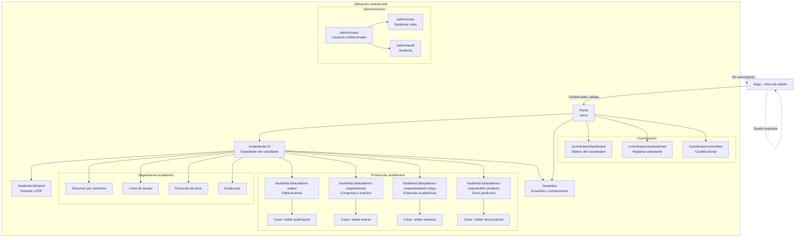
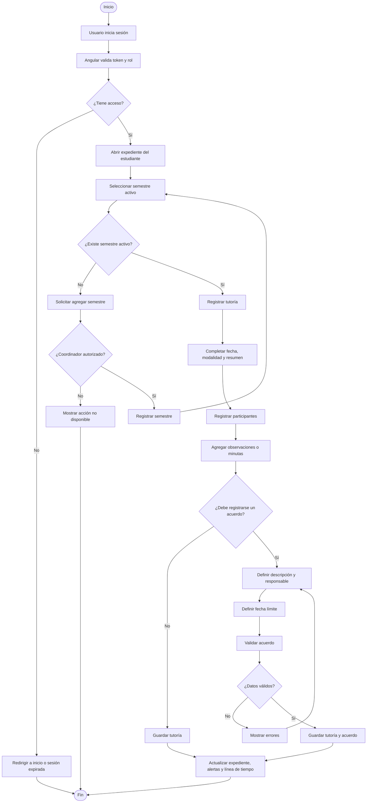
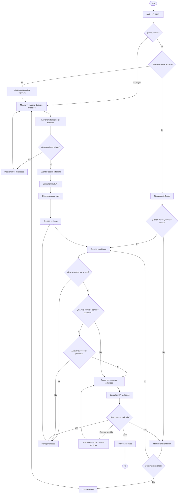

# Diagramas de la aplicación N.E.X.U.S.

Estos diagramas representan las rutas y comportamientos visibles en el frontend Angular actual.

## 1. Diagrama de sitio web

## 2. Diagrama de actividades

Proceso de registro y seguimiento de una tutoría dentro del expediente estudiantil.

## 3. Diagrama de flujo

Proceso de autenticación y control de acceso por ruta.

## 4. Diagrama de casos de uso

```mermaid
flowchart LR
    ESTUDIANTE(["Estudiante"])
    TUTOR(["Tutor"])
    COMITE(["Miembro del comité"])
    COORDINADOR(["Coordinador de programa"])
    ADMIN(["Administrador del sistema"])

    subgraph AUTENTICACION["Autenticación y sesión"]
        UC_LOGIN(["Iniciar sesión"])
        UC_GESTIONAR_SESION(["Gestionar sesión"])
        UC_RENOVAR(["Renovar token"])
        UC_CERRAR(["Cerrar sesión"])
        UC_EXPIRADA(["Consultar sesión expirada"])
    end

    subgraph EXPEDIENTE["Expediente académico"]
        UC_CONSULTAR_EXPEDIENTE(["Consultar expediente"])
        UC_CONSULTAR_RESUMEN(["Consultar resumen académico"])
        UC_CONSULTAR_TIMELINE(["Consultar línea de tiempo"])
        UC_CONSULTAR_EVOLUCION(["Consultar evolución de tesis"])
        UC_REGISTRAR_AVANCE(["Registrar avance de tesis"])
        UC_GESTIONAR_SEMESTRE(["Gestionar semestres"])
        UC_REGISTRAR_SEMESTRE(["Registrar semestre"])
        UC_ACTUALIZAR_SEMESTRE(["Actualizar semestre"])
        UC_GENERAR_REPORTE(["Generar reporte académico"])
        UC_DESCARGAR_PDF(["Descargar reporte en PDF"])
    end

    subgraph TUTORIAS["Tutorías y compromisos"]
        UC_REGISTRAR_TUTORIA(["Registrar tutoría"])
        UC_REGISTRAR_PARTICIPANTES(["Registrar participantes"])
        UC_REGISTRAR_OBSERVACIONES(["Registrar observaciones o minutas"])
        UC_PROGRAMAR_REUNION(["Programar próxima reunión"])
        UC_CONSULTAR_CONDICIONES(["Consultar condiciones de tutoría"])
        UC_CONSULTAR_ACUERDOS(["Consultar acuerdos"])
        UC_REGISTRAR_ACUERDO(["Registrar acuerdo"])
        UC_ASIGNAR_RESPONSABLE(["Asignar responsable y fecha límite"])
        UC_ACTUALIZAR_ACUERDO(["Actualizar estado del acuerdo"])
        UC_CONSULTAR_HISTORIAL(["Consultar historial de acuerdos"])
        UC_CONSULTAR_ALERTAS(["Consultar acuerdos vencidos o próximos a vencer"])
        UC_CONSULTAR_AUDITORIA(["Consultar auditoría del acuerdo"])
    end

    subgraph PRODUCCION["Producción académica"]
        UC_CONSULTAR_PUBLICACIONES(["Consultar publicaciones"])
        UC_REGISTRAR_PUBLICACION(["Registrar publicación"])
        UC_ACTUALIZAR_PUBLICACION(["Actualizar publicación"])
        UC_CONSULTAR_EVENTOS(["Consultar congresos y eventos"])
        UC_REGISTRAR_EVENTO(["Registrar congreso o evento"])
        UC_ACTUALIZAR_EVENTO(["Actualizar congreso o evento"])
        UC_CONSULTAR_ESTANCIAS(["Consultar estancias académicas"])
        UC_REGISTRAR_ESTANCIA(["Registrar estancia académica"])
        UC_ACTUALIZAR_ESTANCIA(["Actualizar estancia académica"])
        UC_CONSULTAR_PRODUCTOS(["Consultar otros productos"])
        UC_REGISTRAR_PRODUCTO(["Registrar otro producto"])
        UC_ACTUALIZAR_PRODUCTO(["Actualizar otro producto"])
    end

    subgraph EVIDENCIAS["Evidencias"]
        UC_SUBIR_EVIDENCIA(["Subir evidencia"])
        UC_CONSULTAR_EVIDENCIAS(["Consultar evidencias"])
        UC_VALIDAR_ARCHIVO(["Validar tipo, firma y tamaño del archivo"])
        UC_ABRIR_EVIDENCIA(["Abrir archivo o enlace de evidencia"])
    end

    subgraph COORDINACION["Coordinación académica"]
        UC_CONSULTAR_DASHBOARD(["Consultar tablero de coordinación"])
        UC_CONSULTAR_ALERTAS_GLOBALES(["Consultar alertas globales"])
        UC_REGISTRAR_ESTUDIANTE(["Registrar estudiante"])
        UC_GESTIONAR_COMITE(["Gestionar comité tutorial"])
        UC_ASIGNAR_ASESOR(["Asignar asesor"])
        UC_ASIGNAR_COASESOR(["Asignar coasesor"])
        UC_ASIGNAR_MIEMBRO(["Asignar miembro del comité"])
    end

    subgraph ADMINISTRACION["Administración institucional"]
        UC_GESTIONAR_USUARIOS(["Gestionar usuarios institucionales"])
        UC_GESTIONAR_ROLES(["Gestionar roles"])
        UC_ASIGNAR_ROL(["Asignar rol a usuario"])
        UC_CONSULTAR_AUDITORIA_ADMIN(["Consultar auditoría institucional"])
    end

    ESTUDIANTE --> UC_LOGIN
    ESTUDIANTE --> UC_CONSULTAR_EXPEDIENTE
    ESTUDIANTE --> UC_CONSULTAR_ACUERDOS
    ESTUDIANTE --> UC_CONSULTAR_HISTORIAL
    ESTUDIANTE --> UC_CONSULTAR_TIMELINE
    ESTUDIANTE --> UC_CONSULTAR_EVOLUCION
    ESTUDIANTE --> UC_SUBIR_EVIDENCIA
    ESTUDIANTE --> UC_CONSULTAR_EVIDENCIAS
    ESTUDIANTE --> UC_CONSULTAR_PUBLICACIONES
    ESTUDIANTE --> UC_REGISTRAR_PUBLICACION
    ESTUDIANTE --> UC_ACTUALIZAR_PUBLICACION
    ESTUDIANTE --> UC_CONSULTAR_EVENTOS
    ESTUDIANTE --> UC_REGISTRAR_EVENTO
    ESTUDIANTE --> UC_ACTUALIZAR_EVENTO
    ESTUDIANTE --> UC_CONSULTAR_ESTANCIAS
    ESTUDIANTE --> UC_REGISTRAR_ESTANCIA
    ESTUDIANTE --> UC_ACTUALIZAR_ESTANCIA
    ESTUDIANTE --> UC_CONSULTAR_PRODUCTOS
    ESTUDIANTE --> UC_REGISTRAR_PRODUCTO
    ESTUDIANTE --> UC_ACTUALIZAR_PRODUCTO
    ESTUDIANTE --> UC_DESCARGAR_PDF

    TUTOR --> UC_LOGIN
    TUTOR --> UC_CONSULTAR_EXPEDIENTE
    TUTOR --> UC_CONSULTAR_RESUMEN
    TUTOR --> UC_REGISTRAR_TUTORIA
    TUTOR --> UC_REGISTRAR_ACUERDO
    TUTOR --> UC_CONSULTAR_ACUERDOS
    TUTOR --> UC_ACTUALIZAR_ACUERDO
    TUTOR --> UC_CONSULTAR_ALERTAS
    TUTOR --> UC_REGISTRAR_AVANCE
    TUTOR --> UC_SUBIR_EVIDENCIA
    TUTOR --> UC_GENERAR_REPORTE

    COMITE --> UC_LOGIN
    COMITE --> UC_CONSULTAR_EXPEDIENTE
    COMITE --> UC_CONSULTAR_RESUMEN
    COMITE --> UC_REGISTRAR_TUTORIA
    COMITE --> UC_REGISTRAR_ACUERDO
    COMITE --> UC_CONSULTAR_ACUERDOS
    COMITE --> UC_ACTUALIZAR_ACUERDO
    COMITE --> UC_CONSULTAR_ALERTAS
    COMITE --> UC_REGISTRAR_AVANCE
    COMITE --> UC_SUBIR_EVIDENCIA
    COMITE --> UC_GENERAR_REPORTE

    COORDINADOR --> UC_LOGIN
    COORDINADOR --> UC_CONSULTAR_DASHBOARD
    COORDINADOR --> UC_CONSULTAR_ALERTAS_GLOBALES
    COORDINADOR --> UC_CONSULTAR_EXPEDIENTE
    COORDINADOR --> UC_GESTIONAR_SEMESTRE
    COORDINADOR --> UC_REGISTRAR_AVANCE
    COORDINADOR --> UC_REGISTRAR_TUTORIA
    COORDINADOR --> UC_REGISTRAR_ACUERDO
    COORDINADOR --> UC_ACTUALIZAR_ACUERDO
    COORDINADOR --> UC_CONSULTAR_ACUERDOS
    COORDINADOR --> UC_CONSULTAR_ALERTAS
    COORDINADOR --> UC_REGISTRAR_ESTUDIANTE
    COORDINADOR --> UC_GESTIONAR_COMITE
    COORDINADOR --> UC_GENERAR_REPORTE

    ADMIN --> UC_LOGIN
    ADMIN --> UC_GESTIONAR_USUARIOS
    ADMIN --> UC_GESTIONAR_ROLES
    ADMIN --> UC_CONSULTAR_AUDITORIA_ADMIN

    UC_LOGIN -.->|"<<include>>"| UC_GESTIONAR_SESION
    UC_GESTIONAR_SESION -.->|"<<extend>>"| UC_RENOVAR
    UC_GESTIONAR_SESION -.->|"<<extend>>"| UC_EXPIRADA
    UC_GESTIONAR_SESION -.->|"<<include>>"| UC_CERRAR

    UC_CONSULTAR_EXPEDIENTE -.->|"<<include>>"| UC_CONSULTAR_RESUMEN
    UC_CONSULTAR_EXPEDIENTE -.->|"<<include>>"| UC_CONSULTAR_TIMELINE
    UC_CONSULTAR_EXPEDIENTE -.->|"<<include>>"| UC_CONSULTAR_EVOLUCION
    UC_CONSULTAR_EXPEDIENTE -.->|"<<include>>"| UC_CONSULTAR_ACUERDOS
    UC_GENERAR_REPORTE -.->|"<<include>>"| UC_CONSULTAR_EXPEDIENTE
    UC_DESCARGAR_PDF -.->|"<<include>>"| UC_GENERAR_REPORTE
    UC_GESTIONAR_SEMESTRE -.->|"<<include>>"| UC_REGISTRAR_SEMESTRE
    UC_GESTIONAR_SEMESTRE -.->|"<<include>>"| UC_ACTUALIZAR_SEMESTRE
    UC_REGISTRAR_AVANCE -.->|"<<extend>>"| UC_CONSULTAR_EVOLUCION
    UC_CONSULTAR_EXPEDIENTE -.->|"<<extend>>"| UC_CONSULTAR_ALERTAS

    UC_REGISTRAR_TUTORIA -.->|"<<include>>"| UC_REGISTRAR_PARTICIPANTES
    UC_REGISTRAR_TUTORIA -.->|"<<include>>"| UC_REGISTRAR_OBSERVACIONES
    UC_REGISTRAR_TUTORIA -.->|"<<include>>"| UC_PROGRAMAR_REUNION
    UC_REGISTRAR_TUTORIA -.->|"<<extend>>"| UC_REGISTRAR_ACUERDO
    UC_REGISTRAR_TUTORIA -.->|"<<extend>>"| UC_CONSULTAR_CONDICIONES
    UC_REGISTRAR_ACUERDO -.->|"<<include>>"| UC_ASIGNAR_RESPONSABLE
    UC_ACTUALIZAR_ACUERDO -.->|"<<include>>"| UC_CONSULTAR_ALERTAS
    UC_ACTUALIZAR_ACUERDO -.->|"<<include>>"| UC_CONSULTAR_AUDITORIA
    UC_CONSULTAR_ACUERDOS -.->|"<<extend>>"| UC_CONSULTAR_HISTORIAL
    UC_CONSULTAR_ACUERDOS -.->|"<<extend>>"| UC_CONSULTAR_ALERTAS

    UC_REGISTRAR_PUBLICACION -.->|"<<include>>"| UC_CONSULTAR_PUBLICACIONES
    UC_ACTUALIZAR_PUBLICACION -.->|"<<include>>"| UC_CONSULTAR_PUBLICACIONES
    UC_REGISTRAR_EVENTO -.->|"<<include>>"| UC_CONSULTAR_EVENTOS
    UC_ACTUALIZAR_EVENTO -.->|"<<include>>"| UC_CONSULTAR_EVENTOS
    UC_REGISTRAR_ESTANCIA -.->|"<<include>>"| UC_CONSULTAR_ESTANCIAS
    UC_ACTUALIZAR_ESTANCIA -.->|"<<include>>"| UC_CONSULTAR_ESTANCIAS
    UC_REGISTRAR_PRODUCTO -.->|"<<include>>"| UC_CONSULTAR_PRODUCTOS
    UC_ACTUALIZAR_PRODUCTO -.->|"<<include>>"| UC_CONSULTAR_PRODUCTOS

    UC_SUBIR_EVIDENCIA -.->|"<<include>>"| UC_VALIDAR_ARCHIVO
    UC_SUBIR_EVIDENCIA -.->|"<<include>>"| UC_CONSULTAR_EXPEDIENTE
    UC_CONSULTAR_EVIDENCIAS -.->|"<<include>>"| UC_ABRIR_EVIDENCIA
    UC_CONSULTAR_EVIDENCIAS -.->|"<<extend>>"| UC_SUBIR_EVIDENCIA

    UC_CONSULTAR_DASHBOARD -.->|"<<include>>"| UC_CONSULTAR_ALERTAS_GLOBALES
    UC_CONSULTAR_DASHBOARD -.->|"<<include>>"| UC_CONSULTAR_EXPEDIENTE
    UC_GESTIONAR_COMITE -.->|"<<include>>"| UC_ASIGNAR_ASESOR
    UC_GESTIONAR_COMITE -.->|"<<include>>"| UC_ASIGNAR_COASESOR
    UC_GESTIONAR_COMITE -.->|"<<include>>"| UC_ASIGNAR_MIEMBRO
    UC_GESTIONAR_COMITE -.->|"<<extend>>"| UC_CONSULTAR_EXPEDIENTE

    UC_GESTIONAR_USUARIOS -.->|"<<include>>"| UC_ASIGNAR_ROL
    UC_GESTIONAR_ROLES -.->|"<<include>>"| UC_ASIGNAR_ROL
    UC_GESTIONAR_USUARIOS -.->|"<<include>>"| UC_CONSULTAR_AUDITORIA_ADMIN
    UC_GESTIONAR_ROLES -.->|"<<include>>"| UC_CONSULTAR_AUDITORIA_ADMIN
```

## Roles considerados

- `STUDENT`: expediente propio, tutorías visibles, producción académica propia y acuerdos asociados.
- `TUTOR`: seguimiento de estudiantes asignados y registros académicos permitidos.
- `COMMITTEE_MEMBER`: consulta y seguimiento de expedientes donde participa.
- `PROGRAM_COORDINATOR`: acceso académico global, registro de estudiantes, comités y tablero coordinador.
- `SYSTEM_ADMIN`: administración de usuarios, roles y auditoría.
